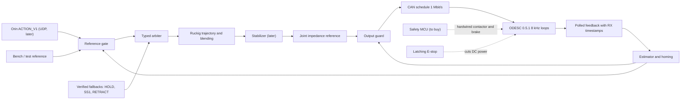

# VAYN-6.2.1 — RT Motion Core Hardening Revision

**Version:** 6.2.1
**Status:** Revision of the frozen VAYN-6.2 baseline. Refines the RT Motion Core only; the 6.2 structure stays frozen.
**Date:** 2026-10-20
**Parent:** [VAYN-6.2](VAYN - 6.2.md)
**Companion docs:**
- [RT Core implementation spec (6.2.1)](Building VAYN - 6.2/RT Core Implementation - VAYN 6.2.1.md): how to build it on the real hardware
- [RT Core from fundamentals to advanced](Building VAYN - 6.2/RT Core - From Fundamentals to Advanced.md): the background needed to understand this document

**Phase-1 RT host:** Dell Latitude 5490 (Intel i5-8350U), Ubuntu 26.04, PREEMPT_RT kernel 7.0
**Phase-1 actuator:** VAYN shoulder: EaglePower LA8308 KV90, 30:1 two-stage planetary, Flipsky ODESC3.6 (firmware 0.5.1), AS5047P motor encoder, DRV5033 hall homing sensor

---

# 1. Summary

VAYN-6.2 defined _what_ the RT Motion Core owns: stabilization, arbitration, safety validation, fallback, trajectory generation, impedance control and final actuator commands. It did not define _how_ to build that core so that it can be checked against real timing and real failures. The architecture rules are sound. What was missing:

- a task and timing model
- a validation stage placed after the controller
- a fault-to-reaction matrix
- a homing strategy for a geared joint
- a CAN bus budget
- numbers that match the hardware we actually own

6.2.1 adds those pieces. It also replaces stale Phase-1 facts with values measured on the real hardware on 2026-10-20:
- the Mac Mini is replaced by the Dell 5490
- the 20:1 and 80:1 gearboxes are replaced by 30:1
- the motor name W92-25 is replaced by LA8308
- the arm (previously "3 kg / 10–13 N·m") is 1.414 kg / 3.26 N·m

The one-line version:

> **6.2 said who owns the robot's body. 6.2.1 says how that owner works, how fast, how it fails, and how we prove it.**

---

# 2. Relation to the 6.2 freeze

6.2 §103–105 freezes the structure and allows parameterized items and experimental modules to change. Every change in 6.2.1 falls into one of those allowed categories.

| 6.2 frozen rule | 6.2.1 status |
| ---| --- |
| THINK / PREDICT / MOVE / SURVIVE | Kept |
| RT Motion Core always owns stabilization | Kept |
| RT Motion Core owns arbitration, safety validation and final actuator commands | Kept, made concrete (§6, I-1 to I-4) |
| Safety MCU is independent and has its own sensing | Kept, strengthened (I-13) |
| State-dependent fallback | Kept, mapped to stop categories (I-12) |
| Skill-specific motion references | Kept; Phase-1 subset defined (§11) |
| Freshness / TTL contracts, versioned interfaces | Kept; `ACTION_ACK_V1` added (I-17) |
| No AI bypass of safety | Kept; enforced by two gates (I-2) |
| AI degradation before safety degradation | Kept |
| Baseline-before-novelty | Kept |

The items 6.2 left open, and how 6.2.1 now fills them:

| 6.2 parameterized item | 6.2.1 value |
| ---| --- |
| RT hardware | Dell Latitude 5490 for Phase 1 (I-6). A dedicated RT computer is decided later |
| Actuator bus | Classic CAN 1 Mbit/s, CANSimple 0.5.1, polled (I-7). Multi-bus or CAN-FD/EtherCAT is an open gate |
| Actuator safety mechanism | Guarded, tethered rig for Phase 1. Brake or other fail-safe is required before unrestricted arm motion |
| Control frequencies | Servo target 1 kHz; 500 Hz accepted if measurements require it |
| Command-expiration window | Phase-1 default 50 ms bounded extrapolation, then HOLD |
| Safety thresholds | From the actuator profile YAML (I-19) |

**Nothing in 6.2.1 reopens the architecture.** None of the 6.2 §104 reopening conditions has been triggered, because nothing has been measured yet.

---

# 3. Verified Phase-1 facts

Each fact below comes from a live read-out or a repository file, not from older docs.

## 3.1 RT host (read from the machine, 2026-10-20)

| Item | Value | Evidence |
| ---| ---| --- |
| Machine | Dell Latitude 5490, BIOS 1.41.0 | `/sys/class/dmi/id` |
| CPU | Intel i5-8350U, 4 cores / 8 threads, 1.7–3.6 GHz | `lscpu` |
| RAM | about 7 GiB usable | `free -h` |
| OS / kernel | Ubuntu 26.04.1, `7.0.0-38-realtime`, `CONFIG_PREEMPT_RT=y`, `HZ=1000`, `NO_HZ_FULL=y`, timerlat tracer built in | `uname`, `/boot/config-*` |
| Ethernet | Intel I219-LM, `e1000e`, hardware TX/RX timestamps | `ethtool -T` |
| CAN | None present; `gs_usb` and `peak_usb` modules available | `ip link`, `modinfo` |
| Current tuning | On battery, `powersave` governor, SMT on, no isolation, user `rtprio` 0, memlock 8 MB, deep C-states down to C10, `dell_smm_hwmon` loaded, `thermald` and `power-profiles-daemon` running | `/sys`, `ulimit`, `lsmod`, `systemctl` |

PREEMPT_RT has been part of the mainline kernel since Linux 6.12 [S1][S2], so the distribution's realtime kernel is a supported configuration rather than an out-of-tree patch.

## 3.2 ODESC3.6 (read-only `odrive` USB dump, no writes)

| Item | Value |
| ---| --- |
| Hardware / firmware | 3.6-56V / 0.5.1, serial `0x378635693034` |
| Control loop rate | 8000 Hz, measured from `loop_counter` over `uptime` |
| Axis0 motor | calibrated: 20 pole pairs (40 magnets, counted), R 0.0846 Ω, L 37 µH, Kt 0.0919 N·m/A, current limit 12 A, `torque_lim` 20, direction -1 |
| Axis0 encoder | `SPI_ABS_AMS` (mode 257), CS on GPIO4, cpr 16384, offset calibrated earlier, `pre_calibrated` False |
| Axis0 controller | TORQUE mode, passthrough input, pos_gain 20, vel_gain 0.1667, vel_integrator_gain 0.333, vel_limit 30 turn/s |
| Watchdog | off (timeout 0.5 s configured) |
| CAN | 250 kbit/s, node ids 0 / 1, heartbeat 100 ms |
| Power config | brake resistor 2.0 Ω, armed; `dc_max_negative_current` -0.01 A; over-voltage trip 54 V; under-voltage 16 V |
| Axis1 | unused (not calibrated) |
| At read time | bench PSU at about 20.1 V, FET temperature about 31 °C, encoder not mounted on the motor (its readings were noise) |

## 3.3 Actuator and arm (Prime-TheHumanoid repo, latest `master`)

| Item | Value | Repo path |
| ---| ---| --- |
| Motor | EaglePower LA8308 KV90, 336 g, Ø92.0 × 32.5 mm | `body parts/shoulder/shoulder-bom.md` P01 |
| Gearbox | 30:1 = stage 1 6:1 (sun 18 / planet 36 / ring 90, m0.8) × stage 2 5:1 (18 / 27 / 72, m1.0) | `shoulder/cad/calc.txt` §8, `odrive/backend/profiles/vayn_shoulder.yaml` |
| Design loads | 30 N·m continuous, 50 N·m proof. Theoretical, not yet tested | `shoulder/cad/calc.txt` §1 |
| Backlash | 0.09–0.22° at the output (0.03–0.07 mm per mesh) | `shoulder/cad/calc.txt` §3 |
| Actuator mass | about 2.76 kg | `shoulder/shoulder-bom.md` |
| Output reference | DRV5033 omnipolar hall sensor plus Ø3 × 2 N52 magnet in the output flange rim; no output encoder | `shoulder-bom.md` P10, P13 |
| Winding NTC | 10 kΩ, planned | `shoulder-bom.md` P14 |
| Arm (v0, no hand) | 2-DOF planar (shoulder pitch, elbow pitch), 1.414 kg, upper arm 298 mm, forearm 234 mm | `arm/cad/mass.txt`, `arm/cad/arm_params.py` |
| Shoulder gravity torque | 3.26 N·m (arm horizontal), 4.33 N·m with 12.57 rad/s² acceleration, about 9.2 N·m at "stage 2" payload | `arm/cad/calc.txt` §1, `arm/research.md` §8 |
| Elbow (later) | T-Motor MN5008 KV170, 14 pole pairs, 20:1 cycloid, backlash 1.22°, current limit 10 A, planned on ODESC axis1 | `elbow/cad/params.py`, `elbow/research.md` §9 |
| Bench tool | `odrive/` GUI: commissioning, health checks, safety layer, CANSimple codec, simulated board | `odrive/docs/*.md` |

## 3.4 Derived numbers used throughout

| Quantity | Value | How |
| ---| ---| --- |
| Motor Kt | 0.0919 N·m/A | 8.27 / KV. ODrive's convention for line-to-line KV [S3][S4]. KV 90 is the seller's figure, not measured |
| Output torque per amp | 2.76 N·m/A ideal; about 2.40 N·m/A at η = 0.87 | Kt × 30 × η. The efficiency is unproven |
| Current to hold the v0 arm horizontal | about 1.4 A | 3.26 / 2.40 |
| One motor turn at the output | 12° | 360° / 30 |
| Motor-encoder resolution at the output | 0.00073° | 360° / 16384 / 30 |
| Motor-encoder accuracy at the output | about ±0.027° | AS5047P nonlinearity ±0.8° [S5][S6] / 30 |
| No-load output speed at 24 V | about 72 rpm = 432°/s | 90 × 24 / 30. Real speed under load is lower |
| Profile velocity limit | 30 motor turn/s = 360°/s at the joint | `vayn_shoulder.yaml` |

---

# 4. Rating of the 6.2 RT Motion Core

| Dimension | Score | Reason |
| ---| ---| --- |
| Architectural principles | 8.5 / 10 | Authority partition, controllability without the AI, freshness, independent safety and baselines match runtime-assurance theory (Simplex) [S7][S8] and current humanoid practice |
| Specification depth | 4 / 10 | Responsibilities are listed, but there is no task model, no timing budget, no RT state machine, no fault-to-reaction matrix and no concrete field lists |
| Safety realism on the real hardware | 5 / 10 | ODESC3.6 has no enable/STO input; when the watchdog or a fault fires the axis goes IDLE and a gravity-loaded arm drops; the Safety MCU shares the control bus; nothing has been bought yet |
| Phase-1 plan | 7 / 10 | Good gating and a characterization-first order, but the plan contradicted itself across docs |
| Documentation consistency | 4 / 10 | Three gear ratios (80:1 / 20:1 / 30:1), two Kt formulas, two names (RHEI / VAYN), output-encoder plans in conflict, Mac Mini still listed |
| Overall readiness | about 6 / 10 | Strong concept; not yet implementable or verifiable |

---

# 5. Findings

Each finding has a root cause and is resolved by one or more improvements in §6.

| ID | Finding | Root cause | Fixed by |
| ---| ---| ---| --- |
| F-1 | 6.2 §8 places safety validation before stabilization and trajectory generation, so the final actuator command is never validated | The pipeline was drawn as a list of responsibilities, not as a data flow | I-2 |
| F-2 | `if (position > max_position) torque = 0` (old implementation flow) and "cut motor current to 0 beyond the soft limit" (`arm/arm_bom.md` §5) drop a gravity-loaded arm and act too late | Limits checked on position only, ignoring velocity and gravity | I-4, I-12 |
| F-3 | The output encoder was treated as precise to 0.022°. That is its resolution; its accuracy is ±0.8° [S5][S6]. Differencing it at 1 kHz gives velocity steps of about 0.38 rad/s | Resolution confused with accuracy | I-9 |
| F-4 | CAN at the current 250 kbit/s cannot carry even one joint at 1 kHz: about 1.3 ms of bus time per poll cycle | The default baud rate was never changed | I-7 |
| F-5 | Firmware 0.5.1 has no periodic encoder broadcast (added in 0.5.2) and no gain setting over CAN (added in 0.5.4) [S9][S10] | Firmware version not considered in the design | I-7, I-8 |
| F-6 | On firmware 0.5.x, every CAN message to an axis feeds the drive watchdog, including polls [S10][S11]. Polling alone can keep a drive armed after the command path has died | Watchdog semantics differ by firmware | I-7, I-14 |
| F-7 | On ODESC3.6, watchdog expiry or any fault puts the axis in IDLE, so the arm falls [S11][S12] | v3.6 hardware has no STO/enable input | I-12, I-14 |
| F-8 | Host-side damping across a 1–3 ms network delay is limited by the sampled-data passivity bound b > KT/2 + |B| [S13][S14] | Impedance loop placed across the network | I-8 |
| F-9 | The laptop is untuned. Dell `dell_smm_hwmon` SMM calls can take about 500 ms [S15]; SMIs are invisible to Linux [S16]; deep C-states add wake-up latency | General-purpose laptop defaults | I-6 |
| F-10 | The 6.2 mode list mixes four separate dimensions: RT lifecycle, reference authority, per-joint drive state and system degradation | One flat enum | I-16 |
| F-11 | At 30:1 a single-turn motor encoder leaves a 12° sector ambiguity at power-up, and the shoulder has no output encoder | Geared joint plus single-turn sensor | I-20 |
| F-12 | Live ODESC config disagrees with the bring-up profile: current limit 12 A vs 6 A, over-voltage trip 54 V vs 28 V | No single checked source of actuator parameters | I-19 |
| F-13 | ODESC motor-thermistor default pin GPIO4 is already used as the encoder chip-select | Pin conflict | §14 gate G-6 |
| F-14 | The purchase list names a Flipsky ODESC V4.2, but the board in hand is an ODESC 3.6 | Repo inconsistency | §14 gate G-8 |

---

# 6. Improvements

Each improvement is written as: problem, root cause, change, why this over the alternatives, regression check against 6.2, and sources.

## A. Authority and pipeline

### I-1 Simplex framing of the RT core

- **Problem.** 6.2 says the RT core owns safety but switches to fallback only on timeouts or faults. That is purely reactive.
- **Root cause.** No formal model of "trusted" versus "untrusted" controllers.
- **Change.** Treat the AI policy (and any learned stabilizer) as the _high-performance, unverified_ controller and the RT core as the _decision module plus verified safety controllers_. This is the Simplex architecture [S7][S8].
    - Each cycle the decision module checks whether the requested reference keeps the joint inside a recoverable envelope (I-4).
    - If not, it switches to a verified fallback reference _before_ a limit is hit.
    - Fallback controllers are simple and testable: HOLD, controlled stop (SS1-style), RETRACT-to-pose.
- **Why this.** Simplex lets complex controllers run safely while only the small decision logic needs to be verified [S7][S8]. The alternative, verifying the neural policy itself, is not practical today.
- **Regression check.** Strengthens 6.2 Rules 1 and 3; no ownership changes.
- **Sources.** [S7] Sha 2001; [S8] Johnson et al. 2016; Seto et al. 1998 [S17].

### I-2 Two validation gates and a reordered pipeline

- **Problem.** F-1.
- **Change.** The servo pipeline is fixed as:

```text
reference gate → arbitration → trajectory/blending → stabilizer → joint impedance → OUTPUT GUARD → driver
```

- **Reference gate (input):** schema and version, required fields, frame and units, freshness (`valid_until`), workspace and joint envelope, rate of change.
- **Output guard (last line):** final position/velocity/torque command limits, slew-rate limits, braking-distance check (I-4), thermal derating (I-11), drive state. Nothing reaches the CAN driver without passing it.
- **Why this.** Defence in depth: the input gate catches bad references early, and the output guard catches bugs in the controller itself. Validating only the input (as 6.2 drew it) leaves the controller unchecked.
- **Regression check.** Same responsibilities as 6.2 §8, in a verifiable order.
- **Sources.** IEC 61800-5-2 places limit monitoring at the drive/output level [S18][S19].

### I-3 Typed arbitration

- **Problem.** 6.2's `u_requested = u_nominal + bounded(Δu_reflex)` does not say what space `u` lives in: positions, velocities, poses or footsteps.
- **Change.**
    - Arbitration works per reference type. A residual is added only to a reference of the same type and frame.
    - The authority envelope is set per degree of freedom, with an absolute cap and a per-cycle rate cap.
    - **The AI may tighten limits but can never loosen them.** Limits come only from the signed actuator profile (I-19).
- **Why this.** It makes the arbitration rule implementable and testable, and prevents unit or frame mix-ups.
- **Regression check.** Implements 6.2 §23–24 exactly.

### I-4 Braking-distance-aware limits

- **Problem.** F-2.
- **Change.** A joint at position q with velocity v and maximum safe deceleration a_max needs a stopping distance of v²/(2·a_max). The output guard therefore checks

```text
q + v·|v| / (2·a_max)  must stay within  [q_min + margin, q_max − margin]
```

If it would leave the range, the guard replaces the reference with a jerk-limited deceleration to a hold at the limit. It never sets torque to zero.
- **Why this.** It stops before the limit instead of after, and keeps gravity compensation active. Cutting torque on a gravity-loaded joint makes it fall, which is the hazard SS2 stops are meant to avoid [S18][S20].
- **Regression check.** Replaces the unsafe example in the old implementation flow; 6.2 joint-limit enforcement is kept.

## B. Timing and tasks

### I-5 Multi-rate fixed-priority task model

- **Problem.** 6.2 lists state estimation (200–500 Hz), stabilization (100–500 Hz) and impedance (500–1000 Hz) but no threads, priorities or hand-off mechanism.
- **Change.**

| Thread | Rate | Policy / priority (target) | CPU | Job |
| ---| ---| ---| ---| --- |
| `servo` | 1 kHz (500 Hz fallback) | SCHED_FIFO 80 | isolated CPU3 | read latest drive feedback, estimate, gate, arbitrate, trajectory, impedance, output guard, transmit CAN |
| `motion` | 100–500 Hz (later) | SCHED_FIFO 70 | CPU2 | whole-body control or MPC; hands results to `servo` |
| `comms` | event-driven | SCHED_FIFO 60 | CPU2 | Orin UDP in/out, Sensor/Safety MCU frames |
| `logger` | best effort | SCHED_OTHER | CPU0–1 | drain lock-free rings into MCAP files |

- Data moves between threads only through lock-free single-producer/single-consumer rings or triple buffers. The `servo` thread never blocks, allocates memory or performs file or network I/O.
- **Why this.** A fixed-priority, rate-monotonic structure is the standard analysable design for periodic control. The rules (clock_nanosleep with absolute time, mlockall, no blocking calls) follow the Linux real-time guidance [S21][S22][S23].
- **Regression check.** Implements 6.2 §53 "hard control loops should not rely on general-purpose messaging deadlines".

### I-6 Dell 5490 host tuning and numeric exit criteria

- **Problem.** F-9.
- **Change** (exact commands are in the implementation spec):
    - Disable Hyper-Threading (BIOS or `nosmt`) to get 4 physical CPUs.
    - Isolate CPU3: `isolcpus=domain,managed_irq,3 nohz_full=3 rcu_nocbs=3 irqaffinity=0-2`.
    - Hold `/dev/cpu_dma_latency` at 0 while the RT core runs, so CPUs stay out of deep C-states.
    - Use the `performance` power profile, run on AC power, and turn Wi-Fi/Bluetooth off during runs.
    - Blacklist `dell_smm_hwmon` and do not run fan-query tools during runs.
    - Grant the RT user `rtprio 90` and unlimited memlock through `/etc/security/limits.d`.
    - Measure with `hwlatdetect`, `cyclictest` and `rtla timerlat`.
- **Exit criteria (targets, to be confirmed by measurement):**
    - `hwlatdetect` maximum below 50 µs over 1 h
    - `cyclictest` on CPU3 under `stress-ng` load: maximum below 100 µs over 24 h
    - zero servo overruns over 10⁷ cycles
- **Why this.** CPU isolation, priorities and absolute sleeps are the documented recipe [S21][S22][S24]. SMIs can only be measured, not blocked, so they have to be measured first [S16][S25]. Dell's SMM-based fan driver is a known source of long SMM stalls [S15].
- **Regression check.** 6.2 §6 "sufficient deterministic timing margin" now has numbers.

### I-7 Time-triggered CAN schedule

- **Problem.** F-4, F-5, F-6.
- **Change.**
    - Run CAN at 1 Mbit/s.
    - Each servo cycle starts with a fixed frame sequence: for each joint, one `Set_Input_Pos` frame (command) and one RTR `Get_Encoder_Estimates` (poll). Once a Sensor MCU exists, a SYNC frame is added at the start of the cycle so it samples in phase.
    - Low-rate polls are added at about 10 Hz: `Get_Vbus_Voltage`, `Get_Iq`. Heartbeat is set to 10 ms. Firmware 0.5.x has no temperature message (the CANSimple table has none) [S10].
    - Hardware RX timestamps from the adapter are used to compute data age.
    - Bus budget, worst case with bit stuffing [S26][S27]:
        - an 8-byte frame takes 135 µs
        - an RTR frame takes 55 µs
        - polling one joint costs about 325 µs per cycle, which is about 33% load at 1 kHz
        - two joints at 1 kHz cost about 65%
    - The design ceiling is 70% load. Above it, use 500 Hz or another bus.
    - The RT core sends commands and polls from the same `servo` thread. If that thread dies, all traffic stops and the drive watchdog fires.
- **Why this.** Polling is forced by firmware 0.5.1. Time-triggered scheduling makes the bus load deterministic. One frame per joint per cycle in each direction is the pattern MIT used on Mini Cheetah (3 motors per 1 Mbit/s bus at 1 kHz) [S28][S29].
- **Scaling note.** A 20–30 joint humanoid at 1 kHz needs about 8–10 classic CAN buses, or CAN-FD, or EtherCAT. This is gate G-4.

## C. Control

### I-8 Joint impedance runs on the drive

- **Problem.** F-8.
- **Change.** In Phase 1 the RT core sends `Set_Input_Pos` (position, velocity feed-forward, torque feed-forward) to an axis in POSITION mode. The ODESC's 8 kHz loops then implement a spring and damper:

```text
τ_motor = vel_gain · (pos_gain · (p_in − p) + v_ff − v) + τ_ff        (vel_integrator_gain = 0)
K_motor = vel_gain · pos_gain / (2π)  [N·m/rad]     D_motor = vel_gain / (2π)  [N·m·s/rad]
K_joint ≈ N² · K_motor,   D_joint ≈ N² · D_motor   (N = 30, gearbox losses ignored)
```

- Because firmware 0.5.1 cannot set gains over CAN, the gains are fixed per test session and set over USB by the bench GUI.
- Host-side torque-mode impedance is Level 2, allowed only after the network delay has been measured and the passivity bound checked.
- **Why this.** It is the same split MIT Mini Cheetah uses: the host sends q_des, v_des, kp, kd, τ_ff and the drive computes the impedance law at 40 kHz [S30][S31]. That avoids putting damping across the network delay [S13][S14].
- **Regression check.** 6.2 §42 impedance control is kept; 6.2's "RT core owns impedance" is kept, because the RT core sets the reference, the feed-forward and the gains.

### I-9 Clear sensor roles

- **Problem.** F-3.
- **Change.**
    - Velocity and fine position come from the motor encoder through the ODESC's PLL estimator (`vel_estimate`), divided by 30.
    - Absolute position comes from homing (I-20) and, later, from an output absolute encoder. The output encoder will be used for the absolute sector, homing without motion, and a two-channel plausibility check: motor position / 30 compared with output position, within backlash plus compliance.
    - The output encoder's ±0.8° nonlinearity is corrected with a lookup table calibrated against the motor encoder.
    - The output encoder is never differentiated at 1 kHz to get velocity.
- **Why this.** It uses each sensor for what it is good at [S5][S6]. Two channels with cross-monitoring is the structure ISO 13849 rewards with diagnostic coverage [S32][S33].

### I-10 Ruckig for trajectories and stops

- **Change.** Online trajectory generation uses Ruckig: time-optimal, jerk-limited motion from any state to any target, real-time capable at 1 kHz [S34][S35]. The same generator produces reference blending, the bounded-extrapolation window and the controlled-stop profiles.
- **Why this.** It is proven, open-source, deterministic and fast. Writing our own S-curve code would be a new source of bugs.

### I-11 Thermal derating

- **Change.**
    - The RT core runs a two-node I²t thermal model (winding and housing) from measured current and derates the torque command smoothly.
    - When the 10 kΩ winding NTC is fitted, the Safety MCU reads it independently as the hard limit.
    - The FET temperature is limited by the ODESC itself, with its thermistor limits set to the profile values (derate from 70 °C, error at 85 °C). Firmware 0.5.1 offers no CAN message for temperature, so the RT core cannot read it at runtime.
- **Why this.** The motor's 22 A rating assumes propeller airflow, and the continuous rating has to come from the thermal hold test. A model fills the gap between samples and before the NTC exists.

## D. Safety

### I-12 Fault-to-reaction matrix mapped to stop categories

- **Change.** Every fault maps to one of three IEC 60204-1 stop categories, which correspond to IEC 61800-5-2 drive functions [S18][S19][S20]:
    - **Cat 0 / STO:** remove torque immediately.
    - **Cat 1 / SS1:** controlled stop, then remove torque.
    - **Cat 2 / SS2:** controlled stop, then hold position with torque.
- Gravity-loaded joints prefer SS2. The Phase-1 matrix is in §9.
- **Why this.** It uses established, auditable vocabulary instead of an ad-hoc "fallback".

### I-13 Safety MCU independence

- **Change.**
    - A hardwired, latching E-stop loop cuts actuator power without software.
    - The Safety MCU drives the contactor and, later, the brake or phase-short through its own GPIO.
    - CAN is used only to _monitor_ (heartbeats, status). It is never the only safety path, because a node in bus-off or a node flooding the bus would disable control and safety at the same time.
    - Later, the Safety MCU gets its own bus or a dedicated line.
- **Why this.** Avoids a common-cause failure. ISO 13850 and NFPA 79 do not allow graphical (software) E-stops; the bench GUI's own safety docs say the same.

### I-14 ODESC limitations are stated explicitly

- **Change.**
    - With no STO input, Cat 0 is only possible by cutting the DC bus.
    - Watchdog expiry or any drive fault disarms the motor [S11][S12], so with the arm attached a fault means the arm falls. Phase 1 therefore runs only on a guarded, tethered rig, as you decided.
    - A bench PSU cannot absorb regenerated energy. The ODESC routes regen into the 2 Ω brake resistor (`dc_max_negative_current = -0.01`), so the resistor must be checked with a multimeter, and the over-voltage trip lowered to about 28 V for a 24 V bus.
    - Whether the clone shorts the phases when idle is unknown (gate G-5).
- **Why this.** Prevents designing around a capability the hardware does not have.

### I-15 Hazard analysis drives the safety design

- **Change.**
    - The Phase-1 safety state table is derived from a short ISO 12100-style risk assessment and an FMEA, not written by intuition.
    - The limits file is versioned and checksummed and can only be loaded while the RT core is in STANDBY (torque off).
- **Why this.** 6.2 §114 already requires hazard analysis before choosing safety levels. This makes it a Phase-1 deliverable.

## E. State, interfaces and verification

### I-16 Four separate state machines

- **Change.** Four state machines, each with its own transition table:
    - **RT lifecycle:** `BOOT → PREFLIGHT → STANDBY → ARMING → ACTIVE → STOPPING → FAULT`, plus `ESTOP`.
    - **Reference authority:** `NONE`, `HOLD`, `LOCAL` (bench or test trajectories), `AI`, `FALLBACK`.
    - **Per joint:** modelled on CiA 402, which eases a later move to EtherCAT drives [S36][S37]. The states are `DISABLED`, `READY`, `ENABLED`, `QUICK_STOP`, `FAULT_REACTION`, `FAULT`.
    - **System degradation:** the 6.2 modes (`FULL` … `EMERGENCY`) are kept as _inputs_ to the RT core, not as its internal state.
- **Why this.** Separate machines are smaller and testable, and the CiA 402 per-joint model is an industry standard.

### I-17 Interfaces and time

- **Change.**
    - Adopt `ACTION_ACK_V1` and executed-action history from 6.3 now, because they cost little in Phase 1.
    - `STATE_V1` carries capture timestamps.
    - The Orin talks to the RT core over a dedicated Ethernet link using UDP with a fixed binary schema plus version and CRC.
    - PTP via linuxptp is used for the Orin–RT clock, since the I219-LM has hardware timestamps.
    - ROS 2 stays out of the servo loop.
- **Why this.** Execution feedback and explicit clocks make staleness and arbitration measurable (6.3 §2.3).

### I-18 Deterministic core

- **Change.**
    - The control logic is a pure function `step(inputs, state, t) → (outputs, state)` with an injected clock.
    - The same binary runs against the simulator, against recorded logs (replay), in HIL and on the robot.
    - Logs are written as MCAP through a lock-free ring [S38][S39].
- **Why this.** Bugs become reproducible, and 6.2 §71 (replay) becomes cheap.

### I-19 The actuator profile is the single source of actuator truth

- **Problem.** F-12.
- **Change.**
    - The bench GUI profile (`odrive/backend/profiles/vayn_shoulder.yaml`) is the single source for ratio, KV, pole pairs, limits, power and thermal thresholds.
    - The RT core reads it, records its SHA-256 in every log, and adds only RT-specific settings (CAN node id, rates, homing) in its own joint file.
    - Before arming, a read-only USB preflight tool compares the live ODESC configuration with the profile and the RT settings: CAN baud, node id, watchdog enabled and timeout, `pre_calibrated`, current limit, velocity limit, over-voltage trip, pole pairs, encoder mode.
    - The RT core refuses to arm on any mismatch. This is needed because firmware 0.5.1 cannot report its configuration over CAN.

### I-20 Homing and absolute-angle state machine

- **Problem.** F-11.
- **Change.** Per joint: `UNHOMED → HOMING → HOMED → LOST`. Position control is not allowed while UNHOMED. The method is in §8.

---

# 7. Revised RT Motion Core reference architecture



## 7.1 Servo-cycle timing budget (targets; to be measured)

| Stage | Budget at 1 kHz |
| ---| --- |
| Wake-up latency (p99.99) | ≤ 100 µs |
| Read feedback, estimate, gate, arbitrate, trajectory, impedance, guard (WCET) | ≤ 50 µs |
| Queue CAN frames to SocketCAN | ≤ 20 µs |
| Bus time, 1 joint / 2 joints worst case | 325 µs / 650 µs |
| Feedback-to-use delay | 1 cycle (pipelined) |
| Slack | ≥ 300 µs for 1 joint |

If the measured CAN poll round-trip (send to reply, from hardware timestamps) has a p99.9 above 800 µs, the servo rate drops to 500 Hz. Nothing else in the design changes.

---

# 8. Absolute joint angle and homing (answers "how are we going to do it")

At 30:1, one motor turn equals 12° at the joint. The motor AS5047P knows the angle _inside_ a motor turn as soon as it powers up. It does not know _which_ of the 30 turns (sectors) the joint is in. Homing only has to identify the sector:

```text
joint_angle = (k + φ) · 12° + q_offset
  φ        = motor angle within one turn, from the motor encoder, in [0, 1)
  k        = sector index (integer), the unknown at power-up
  q_offset = constant, calibrated once with the joint at a precisely known pose
```

This works because 30:1 is an exact integer ratio (stage 1 = 1 + 90/18 = 6, stage 2 = 1 + 72/18 = 5). Each joint position always maps to the same φ, repeating every 12°.

Any reference that gives the joint angle to better than ±6°, minus backlash (0.1–0.2°) and a margin, picks k uniquely. After that, precision comes from the motor encoder (about 0.03° at the joint), not from the reference. `q_offset` must be re-calibrated after any gearbox or encoder re-assembly.

**Phase 1A (no extra hardware): reference-pose homing.**
1. With the axis IDLE, the operator moves the arm by hand to a marked reference pose (jig or a hard-stop mark), which is easily within ±6°.
2. The RT core reads φ over CAN, chooses the k that matches the known reference angle, and stores the offset.
3. The joint is now HOMED.

**Phase 1B (recommended target): automatic hall homing.**
1. The DRV5033 output is read by a small CAN **Sensor MCU**.
2. The RT core drives a slow, low-current sweep until the hall edge is seen, captures φ at the edge, and resolves k.

The hall sensor is not wired to the ODESC endstop input because:
- on firmware 0.5.1, CAN cannot report GPIO or endstop state
- ODrive fixed a homing race condition only in 0.5.6 [S9][S10]

The same Sensor MCU later carries the output encoders and the IMU. The DRV5033 was chosen in the CAD for its 20–30 kHz bandwidth (`shoulder-bom.md` §0).

**Phase 2 (later): output absolute encoder.** Gives homing without motion at power-up and a two-channel plausibility check. This matters for legs, which should not sweep at every boot. The elbow design already includes one.

**LOST.** The joint goes to LOST, and position control is disabled, if:
- the ODESC reboots or its heartbeat shows an encoder error
- feedback is missing for longer than the hold time
- the motor-to-output plausibility check fails (once an output encoder exists)

Note: the motor encoder is currently **not mounted**. After it is re-mounted, the encoder offset calibration must be redone. Re-seating the PCB or magnet changes the electrical offset, so the old offset (-153) must not be trusted.

---

# 9. Phase-1 safety

## 9.1 Setup

- Single shoulder actuator on a **guarded, tethered rig**.
- Bench PSU at 24 V with a current limit.
- A latching E-stop that cuts PSU output (to buy).
- ODESC watchdog enabled.
- No Safety MCU yet.

**Assumption until G-5 is closed:** any drive fault can drop the arm. The rig must be able to take that safely.

## 9.2 Fault-reaction matrix

| Fault | Detected by | Reaction | Stop category |
| ---| ---| ---| --- |
| AI reference stale (`valid_until` passed) | Reference gate | Bounded extrapolation for at most 50 ms, then HOLD | SS2 (hold) |
| Reference invalid (schema, frame, units, envelope) | Reference gate | Reject; keep the previous valid reference or HOLD | none / SS2 |
| Braking distance would cross a soft limit | Output guard | Jerk-limited deceleration, hold at the limit | SS2 |
| Following error above threshold | Output guard | Controlled stop, then hold; if it persists, FAULT and request IDLE | SS1 → Cat 0 |
| Velocity above limit | Output guard and ODESC overspeed | Controlled stop; the ODESC trips if exceeded by its tolerance | SS1 / Cat 0 |
| Single servo overrun | Servo thread | Log and count | none |
| 3 consecutive overruns | Servo thread | Controlled stop, then hold | SS1 → SS2 |
| No encoder reply for > 5 cycles | Servo thread | Stop commanding and request IDLE; ODESC watchdog backs this up | Cat 0 (rig) |
| ODESC axis error in heartbeat | Heartbeat decode | Drive is already IDLE; RT core goes to FAULT, logs the code, requires operator reset | Cat 0 |
| FET temperature above warning / abort | The ODESC itself: `fet_thermistor.config.temp_limit_lower/upper` set to the profile's 70 / 85 °C. Firmware 0.5.1 has no CAN temperature message, so the RT core cannot poll it | Drive derates current between the two limits and errors above the upper one; the RT core then sees the axis error in the heartbeat | derate / Cat 0 |
| Thermal model or NTC above limit | RT model / Safety MCU (later) | Derate / controlled stop | SS1 |
| Bus voltage outside window | `Get_Vbus_Voltage` poll | Controlled stop and FAULT | SS1 |
| RT process crash or laptop hang | ODESC watchdog (no CAN traffic) | Drive disarms | Cat 0 (rig) |
| ODESC reboot | Heartbeat state change | Joint goes to LOST, RT core to FAULT | Cat 0 |
| E-stop pressed | Hardware (PSU cut) | Power removed; RT core sees undervoltage or loss of heartbeat and goes to FAULT | Cat 0 |

---

# 10. State machines (summary)

Full transition tables are in the implementation spec.

- **RT lifecycle:**
    - `BOOT → PREFLIGHT` (profile and USB config check) `→ STANDBY` (torque off; the only state where limits can be loaded)
    - `→ ARMING` (enter closed loop with the setpoint equal to the current position) `→ ACTIVE`
    - `→ STOPPING` (SS1/SS2) `→ STANDBY` or `FAULT`
    - `ESTOP` is reachable from any state.
- **Reference authority:** `NONE → HOLD → LOCAL | AI`; any fault moves it to `FALLBACK`. The operator returns it.
- **Per joint (CiA 402-like):** `DISABLED → READY → ENABLED ⇄ QUICK_STOP`; any fault goes to `FAULT_REACTION → FAULT`.
- **Homing:** `UNHOMED → HOMING → HOMED → LOST`.

---

# 11. Interfaces (Phase-1 subset)

All interfaces carry `interface_version`, `timestamp` (64-bit monotonic ns), `sequence_id` and `source_id`. Fields are classed REQUIRED / OPTIONAL / DEFAULTED / FORBIDDEN as in 6.2 §22.

- **`ACTION_V1`** **/** **`JOINT_REFERENCE`** (Phase-1 type):
    - REQUIRED: `joint_id`, `frame` (joint), `units` (SI: rad, rad/s, N·m), `q_ref`, `valid_until`
    - OPTIONAL: `qd_ref`, `tau_ff`
    - DEFAULTED: `max_vel`, `max_acc`, `max_jerk` (profile defaults; may only be tighter)
    - FORBIDDEN: any field that raises a limit
- **`STATE_V1`** **additions:**
    - `capture_time` for each source
    - `homing_state`, `lifecycle_state`, `authority`, `drive_state`, `drive_error`
    - `thermal_estimate`, `bus_voltage`
    - `profile_sha256`
- **`ACTION_ACK_V1`** (from 6.3): `command_id`, `received_at`, `accepted_at`, `committed_at`, `accepted`, `committed_reference`, `safety_clipped`, `residual_applied`, `controller_mode`, `valid_until`, `following_error`.
- **`SAFETY_V1`****:** unchanged from 6.2. Implemented on the Safety MCU when it exists.

---

# 12. CAN bus budget and scaling

| Case | Bus time per cycle (worst case, 1 Mbit/s) | Load at 1 kHz | Load at 500 Hz |
| ---| ---| ---| --- |
| 1 joint, polled (fw 0.5.1) | 325 µs | 33% | 16% |
| 2 joints (shoulder and elbow) | 650 µs | 65% | 33% |
| 1 joint at the current 250 kbit/s | 1300 µs | 130% (impossible) | 65% |
| 1 joint, cyclic feedback (fw ≥ 0.5.2) | 270 µs | 27% | 14% |

Frame times: 135 µs per 8-byte frame and 55 µs per RTR frame, worst-case stuffing included [S26][S27]. Heartbeat at 10 ms and the 10 Hz polls add under 2%.

For about 20–30 joints at 1 kHz with this protocol, about 3 joints fit per bus, so roughly 8–10 buses are needed. The alternatives (CAN-FD, EtherCAT drives, or an IO-bridge MCU that fans out several CAN buses) are gate G-4.

---

# 13. Updated frozen / parameterized / experimental lists

**Frozen (6.2 list, unchanged), plus these 6.2.1 additions:**
- Two validation gates (reference gate and output guard)
- Braking-distance-aware limits; never torque-off as a limit reaction on gravity-loaded joints
- The actuator profile is the single source of actuator parameters; the AI may only tighten limits
- Homing state machine; no position control while unhomed
- The servo thread owns all actuator bus traffic

**Parameterized:**
- RT hardware (Phase 1: Dell 5490)
- Servo rate (1 kHz target, 500 Hz fallback)
- Bus (CAN 1 Mbit/s for Phase 1)
- Extrapolation window (50 ms default)
- Impedance gains
- Thermal model constants
- Thresholds in the profile
- Homing method (1A / 1B / 2)

**Experimental (unchanged from 6.2), plus:** host-side torque-mode impedance (Level 2); firmware upgrade to 0.5.6.

---

# 14. Open gates and decisions

| Gate | Question | How to close |
| ---| ---| --- |
| G-1 | Can the Dell 5490 meet the I-6 latency targets? | `hwlatdetect`, `cyclictest`, `rtla` measurements |
| G-2 | USB-CAN round-trip and jitter | Measure with hardware timestamps after buying the adapter |
| G-3 | Real Kt, efficiency, friction, backlash and continuous current | GUI characterization and thermal hold tests |
| G-4 | Bus architecture for 20–30 joints | Trade study: multi-CAN vs CAN-FD vs EtherCAT, using measured G-2 data |
| G-5 | Does the ODESC clone short the motor phases when idle? (passive braking) | Bench measurement: back-drive torque with the axis IDLE and with power off |
| G-6 | Motor NTC pin: GPIO4 is the encoder CS | Choose another analog GPIO on the clone (GPIO3 is the likely candidate) or route the NTC to the Safety MCU only; verify on hardware |
| G-7 | Firmware 0.5.1 stays (your decision) | Re-evaluate only if polling or gain limits block a milestone |
| G-8 | Purchase list says ODESC V4.2; we own a 3.6 | Decide which board the arm standardizes on before buying more |
| G-9 | Brake or other fail-safe mechanism before arm motion outside the rig | Actuator design decision |
| G-10 | Bench PSU rating unknown | Read its label; it must supply at least 24 V and about 10 A in constant-current mode |

---

# 15. Documentation corrections applied with this revision

The following docs were corrected in place with a dated revision note (both locally and in ClickUp):
- [03 Electronic integration](Building VAYN - 6.2/VAYN Electronic.md)
- [05 Building VAYN 6.2](Building VAYN - 6.2/Building VAYN - 6.2.md)
- [07 Implementation flow](Building VAYN - 6.2/Implementation Flow - VAYN 6.2.md)
- [08 Phase-1 electronics](Building VAYN - 6.2/VAYN — Phase 1 Electronics + RT Core Architecture.md)
- [08a Motor specification](Building VAYN - 6.2/motor specification and actuator details.md)
- [core/10 Phase-1 electronics + RT core](Building VAYN - 6.2/VAYN - Phase 1 Electronics + RT Core Architecture.md)
- [core/07 VAYN-6.2](VAYN - 6.2.md): pointer to this revision only

Corrections:
- Mac Mini → Dell 5490
- 80:1 / 20:1 → 30:1 (6:1 × 5:1)
- W92-25 → LA8308 KV90
- 18° sector → 12°
- one Kt convention (8.27 / KV)
- firmware 0.5.1 facts
- bench PSU instead of a 6S battery for Phase 1
- arm 1.414 kg / 3.26 N·m
- hall homing as the output reference
- torque targets 30 / 50 N·m, untested
- RHEI → VAYN

The history docs (VAYN 1–6, 6.3, 7) are unchanged.

---

# 16. References

- [S1] Phoronix, "Real-Time PREEMPT_RT Support Merged For Linux 6.12", 2024. [https://www.phoronix.com/news/Linux-6.12-Does-Real-Time](https://www.phoronix.com/news/Linux-6.12-Does-Real-Time)
- [S2] T. Gleixner, "[GIT pull] sched/rt for v6.12-rc1", LKML, 2024; LWN "The 6.12 merge window begins". [https://lwn.net/Articles/990750/](https://lwn.net/Articles/990750/)
- [S3] ODrive docs, "Component Selection: Kv / torque constant", k_t = 8.27 / k_v. [https://docs.odriverobotics.com/v/latest/articles/component-selection.html](https://docs.odriverobotics.com/v/latest/articles/component-selection.html)
- [S4] ODrive Community, "Where does the formula for calculating torque come from?" (3/2 · 1/√3 · 60/2π). [https://discourse.odriverobotics.com/t/where-does-the-formula-for-calculating-torque-come-from/1169](https://discourse.odriverobotics.com/t/where-does-the-formula-for-calculating-torque-come-from/1169)
- [S5] ams OSRAM, AS5047P datasheet DS000324 (INL ±0.8°, noise 0.068° RMS, SPI delay 90–110 µs). [https://look.ams-osram.com/m/d05ee39221f9857/original/AS5047P-DS000324.pdf](https://look.ams-osram.com/m/d05ee39221f9857/original/AS5047P-DS000324.pdf)
- [S6] Infineon, AS5047P datasheet (same figures). [https://www.infineon.com/part/AS5047P](https://www.infineon.com/part/AS5047P)
- [S7] L. Sha, "Using Simplicity to Control Complexity", IEEE Software 18(4), 2001. [https://doi.org/10.1109/MS.2001.936213](https://doi.org/10.1109/MS.2001.936213)
- [S8] T. T. Johnson et al., "Real-Time Reachability for Verified Simplex Design", ACM TECS, 2016. [https://www.taylortjohnson.com/research/johnson2016tecs.pdf](https://www.taylortjohnson.com/research/johnson2016tecs.pdf)
- [S9] ODrive docs 0.5.6, Changelog (0.5.2 periodic encoder messages; 0.5.4 gains over CAN; 0.5.6 homing race fix, cyclic message rates). [https://docs.odriverobotics.com/v/0.5.6/changelog.html](https://docs.odriverobotics.com/v/0.5.6/changelog.html)
- [S10] ODrive docs 0.5.6, CAN Protocol (CANSimple message table, RTR call-and-response). [https://docs.odriverobotics.com/v/0.5.6/can-protocol.html](https://docs.odriverobotics.com/v/0.5.6/can-protocol.html)
- [S11] ODrive docs 0.5.6, Getting Started: watchdog ("most CANSimple commands feed the watchdog"); ODrive 0.6 changelog ("previously, all CAN messages fed the watchdog"). [https://docs.odriverobotics.com/v/0.5.6/getting-started.html](https://docs.odriverobotics.com/v/0.5.6/getting-started.html) , [https://docs.odriverobotics.com/v/latest/changelog.html](https://docs.odriverobotics.com/v/latest/changelog.html)
- [S12] ODrive firmware `main.cpp` (motor disarm when the watchdog is not OK) and `odrive-interface.yaml` (`WATCHDOG_TIMER_EXPIRED`). [https://github.com/odriverobotics/ODrive](https://github.com/odriverobotics/ODrive)
- [S13] J. E. Colgate, G. Schenkel, "Passivity of a class of sampled-data systems", J. Robotic Systems 14(1), 1997.
- [S14] J. E. Colgate, J. M. Brown, "Factors Affecting the Z-Width of a Haptic Display", ICRA 1994 (b > KT/2 + |B|). [https://cim.mcgill.ca/~hayward/Teach/papers/Part-II/Colgate-Brown-94.pdf](https://cim.mcgill.ca/~hayward/Teach/papers/Part-II/Colgate-Brown-94.pdf)
- [S15] Linux kernel docs, "dell-smm-hwmon" (some SMM calls take about 500 ms). [https://docs.kernel.org/hwmon/dell-smm-hwmon.html](https://docs.kernel.org/hwmon/dell-smm-hwmon.html)
- [S16] Linux kernel docs, "Hardware Latency Detector". [https://kernel.org/doc/html/latest/trace/hwlat_detector.html](https://kernel.org/doc/html/latest/trace/hwlat_detector.html)
- [S17] D. Seto, B. Krogh, L. Sha, A. Chutinan, "The Simplex Architecture for Safe On-Line Control System Upgrades", ACC 1998.
- [S18] Pilz, "EN / IEC 61800-5-2" (STO/SS1/SS2 ↔ stop categories 0/1/2). [https://www.pilz.com/en-US/support/lexicon/articles/200448](https://www.pilz.com/en-US/support/lexicon/articles/200448)
- [S19] SEW-Eurodrive, "Stop categories in accordance with EN 60204-1". [https://download.sew-eurodrive.com/download/html/33354944/en-EN/4122370023561850127627.html](https://download.sew-eurodrive.com/download/html/33354944/en-EN/4122370023561850127627.html)
- [S20] Machinery Safety 101, "Safe Drive Control including STO" (SS2 for axes that would fall). [https://machinerysafety101.com/2017/07/03/safe-drive-control-sto/](https://machinerysafety101.com/2017/07/03/safe-drive-control-sto/)
- [S21] Linux kernel docs, "Real-time application monitors" (clock_nanosleep with TIMER_ABSTIME, no CLOCK_REALTIME). [https://docs.kernel.org/trace/rv/monitor_rtapp.html](https://docs.kernel.org/trace/rv/monitor_rtapp.html)
- [S22] [realtime-linux.org](http://realtime-linux.org), "A Checklist for Real-Time Applications in Linux". [https://realtime-linux.org/a-checklist-for-real-time-applications-in-linux/](https://realtime-linux.org/a-checklist-for-real-time-applications-in-linux/)
- [S23] J. Ogness, "A Checklist for Writing Linux Real-Time Applications", ELC-E 2020. [https://ogness.net/ese2020/ese2020_johnogness_rtchecklist.pdf](https://ogness.net/ese2020/ese2020_johnogness_rtchecklist.pdf)
- [S24] Intel ECI docs, "Real-Time Scheduling on Linux" (isolcpus, nohz_full, rcu_nocbs, irqaffinity). [https://eci.intel.com/docs/3.3/development/performance/rt_scheduling.html](https://eci.intel.com/docs/3.3/development/performance/rt_scheduling.html)
- [S25] Red Hat, "Running and interpreting hardware and firmware latency tests" (hwlatdetect; do not fully disable SMIs). RHEL for Real Time 8 docs.
- [S26] T. Nolte et al., "Using bit-stuffing distributions in CAN analysis" (135 bit-times for the largest standard frame). [http://www.es.mdh.se/pdf_publications/298.pdf](http://www.es.mdh.se/pdf_publications/298.pdf)
- [S27] Vector, "CAN bit stuffing" (24 stuff bits worst case); Linux `can: length` patch (frame-length table). [https://certification.vector.com/mod/page/view.php?id=349](https://certification.vector.com/mod/page/view.php?id=349)
- [S28] D. Kang, "What is CAN?" (Mini Cheetah: 4 buses × 3 motors at 1 kHz, about 22% load per actuator). [https://dokkev.github.io/aboutcan/](https://dokkev.github.io/aboutcan/)
- [S29] Robots Guide, "Mini Cheetah" (UP board, PREEMPT_RT, 40 kHz actuator loops). [https://robotsguide.com/robots/minicheetah](https://robotsguide.com/robots/minicheetah)
- [S30] B. Katz, "Low Cost, High Performance Actuators for Dynamic Robots", MIT thesis (pseudo-impedance on the driver). [https://fab.cba.mit.edu/classes/865.18/motion/papers/katz-thesis.pdf](https://fab.cba.mit.edu/classes/865.18/motion/papers/katz-thesis.pdf)
- [S31] B. Katz, HKC_MiniCheetah firmware (CAN command p, v, kp, kd, τ_ff). [https://os.mbed.com/users/benkatz/code/HKC_MiniCheetah/](https://os.mbed.com/users/benkatz/code/HKC_MiniCheetah/)
- [S32] ISO 13849-1:2023, Safety-related parts of control systems (categories, diagnostic coverage).
- [S33] IEC 61800-5-2, Adjustable speed electrical power drive systems — functional safety.
- [S34] L. Berscheid, T. Kröger, "Jerk-limited Real-time Trajectory Generation with Arbitrary Target States", RSS 2021. [https://www.roboticsproceedings.org/rss17/p015.html](https://www.roboticsproceedings.org/rss17/p015.html)
- [S35] Ruckig repository. [https://github.com/pantor/ruckig](https://github.com/pantor/ruckig)
- [S36] CAN in Automation, CiA 402 drives and motion control profile. [https://can-cia.org/can-knowledge/cia-402-series-canopen-device-profile-for-drives-and-motion-control](https://can-cia.org/can-knowledge/cia-402-series-canopen-device-profile-for-drives-and-motion-control)
- [S37] Novanta, "CiA 402 State Machine". [https://drives.novantamotion.com/emcl/cia-402-state-machine](https://drives.novantamotion.com/emcl/cia-402-state-machine)
- [S38] MCAP format specification. [https://github.com/foxglove/mcap](https://github.com/foxglove/mcap)
- [S39] ROS 2 rosbag2: MCAP is the default storage. [https://github.com/ros2/rosbag2](https://github.com/ros2/rosbag2)
