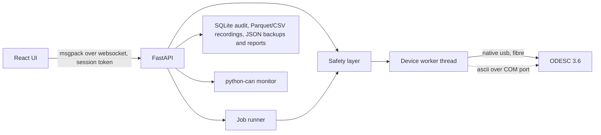

# Architecture



## Backend (`backend/app`)

| module | role |
|---|---|
| `device.py` | the only thread that touches the device. Runs queued ops in order, samples telemetry at the requested rate, reconnects by serial after reboot/unplug, highest-priority disarm |
| `transport/fibre_usb.py` | official `odrive` 0.5.1 python package; caches a handle per property for ~0.4 ms reads |
| `transport/ascii_serial.py` | fallback over the CDC COM port (`r`/`w`/`ss`/`se`/`sr`/`u`), pipelined reads (~170 Hz for 10 values) |
| `transport/mock.py` | simulated 0.5.1 board with motor physics, calibration, watchdog and reboot; starts in the real board's state |
| `aliases.py` | stable names (`fet_temp.0`) for paths that moved between fw 0.5.1 and 0.5.6 |
| `meta.py` + `metadata/` | units, docs, enum names and 64-bit error flags generated from the firmware's `odrive-interface.yaml` (`tools/gen_metadata.py`) |
| `safety.py` | limits, confirmation tokens, watchdog feeding, telemetry monitor, alarms, audit ([SAFETY.md](SAFETY.md)) |
| `jobs/` | long tests as server-side tasks: calibration, profile apply, health, step/sweep/sine, thermal, friction, Kt, backlash, firmware |
| `storage.py` | audit log, recordings, backups, reports |
| `can_bus.py` | python-can bus, ODrive CANSimple decode/encode |
| `main.py` | websocket rpc (`op` table), status/telemetry pumps, downloads, serves the built UI |

### Why one device thread
The fibre/ascii links are not safe for concurrent use. A single owner keeps request order
deterministic, lets the disarm request jump the queue, and makes reconnects simple.

### Telemetry
The worker always samples a safety base set (bus, states, error registers, currents, temps,
position, velocity) plus the union of what the UI, jobs and the recorder subscribed. Rows are
stamped with host time; the device clock (`loop_counter` on 0.5.1, `n_evt_control_loop` on 0.5.6)
is in the base set. Achieved rate is shown in the status bar (~60-100 Hz over usb with ~30 channels;
USB on 0.5.x cannot stream kHz data).

### Protocol
Browser -> server: `{id, op, args}`. Server -> browser: `{t:'res', id, ok, data|error, code}`,
`{t:'tel', cols, ts, rows}`, `{t:'status'}`, `{t:'event'}`, `{t:'job'}`, `{t:'can'}`.
msgpack keeps NaN/inf floats and 64-bit ints intact (the reference GUI broke on `torque_lim = inf`).
A response with `code: 'confirm'` means "ask the user, call `arm`, retry with the token".

### Security
Binds to 127.0.0.1 only, websocket needs the per-start session token and an allowed Origin
(other websites cannot drive the motor). Downloads need the token as a query parameter.

## Frontend (`frontend/src`)

- `lib/rpc.ts` websocket client, 500 ms heartbeat (the backend disarms if it stops)
- `lib/telemetry.ts` shared ring buffers (Float64Array) + M4 downsampling for plots
- `lib/store.ts` zustand state, `act()` (handles confirmation), `useStream`/`useLatest`, sticky job runner
- `components/Plot.tsx` uPlot live and static charts
- `views/*` one file per screen; `views/registry.ts` lists them

## Folders

```
odrive/
  backend/   app/ metadata/ profiles/ tests/ run.py vayn-odrv.spec
  frontend/  src/ index.html vite.config.ts
  tools/     gen_metadata.py fix_winusb_guid.ps1
  docs/
```
Runtime data (`backend/data/`): `audit.db`, `recordings/`, `backups/`, `reports/`, `firmware/`, `profile.yaml`.
